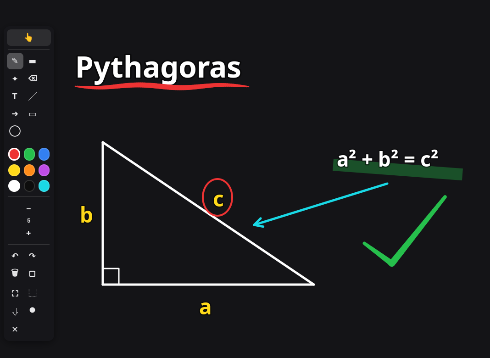
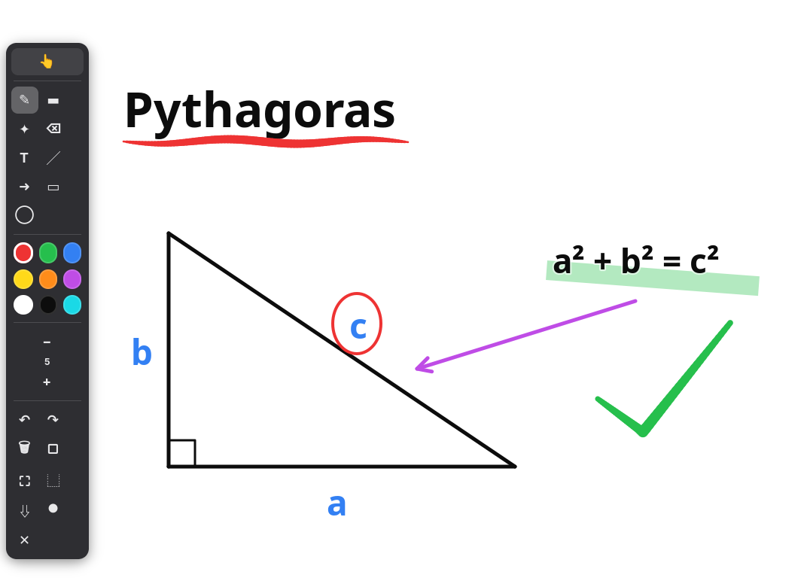
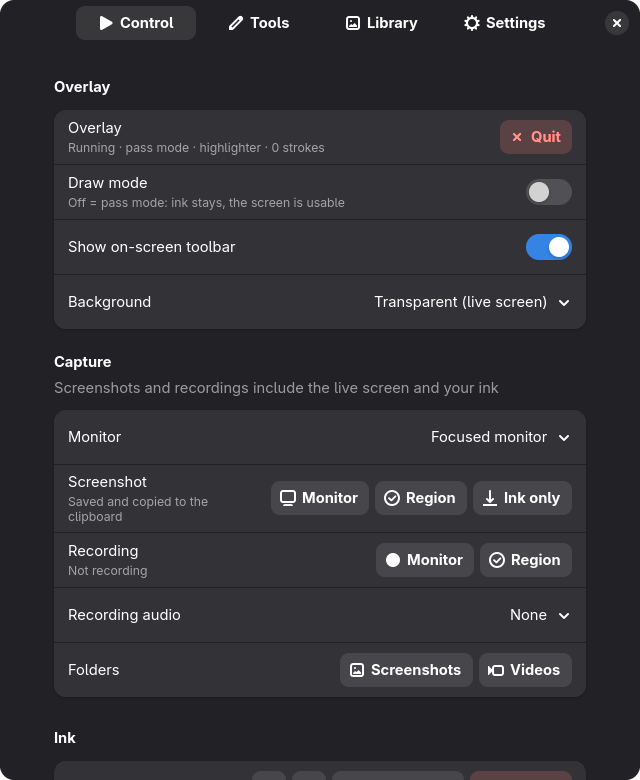
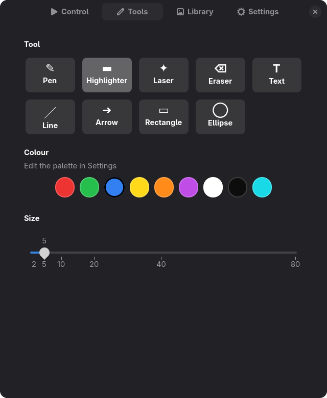
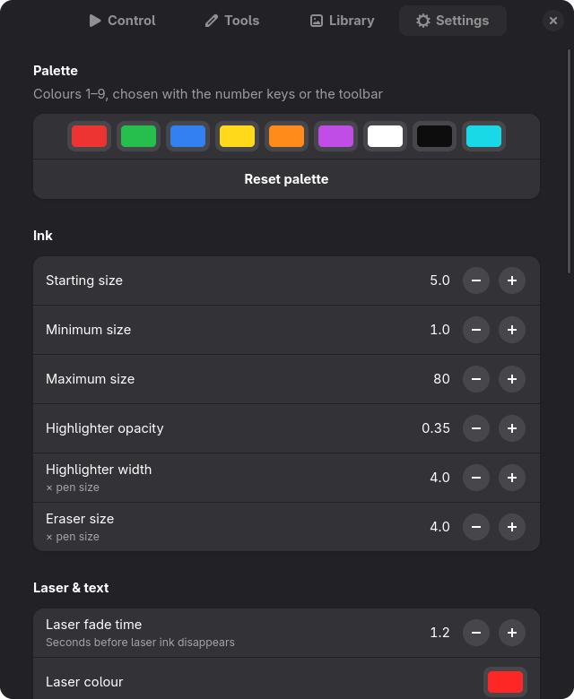

# inkover

Draw on your **live** screen with a pen tablet (or mouse) on Wayland.

inkover puts a transparent [layer-shell](https://github.com/wmww/gtk4-layer-shell)
overlay on every monitor. Whatever is underneath keeps playing and updating.
You write on top of it with pressure-sensitive ink, then flip to **pass** mode to
keep the ink on screen while you click and type in the apps below.

<p align="center">
  
  
</p>
<p align="center"><sub>Blackboard and whiteboard backgrounds. The default is transparent, so you draw straight over whatever's on screen.</sub></p>

Built and tested on Hyprland with a Wacom Intuos. It should work on any
compositor that supports `wlr-layer-shell` (Sway, river, niri, KDE…).

## Features

- **Pressure-sensitive pen**: line width follows how hard you press
- **Highlighter, laser pointer** (ink that fades away by itself), **eraser**, **text**
- **Shapes**: line, arrow, rectangle, ellipse; hold **Shift** for straight pen lines
- **Pen side buttons / eraser tip** erase while held (configurable)
- **Draw / pass modes**: in pass mode the ink stays and the screen stays usable;
  a single floating button brings you back to drawing
- **Pen-friendly toolbar** with tools, nine colours, size, undo/redo, clear, board
- **Whiteboard / blackboard** background toggle
- **Screenshots**: whole monitor or a selected region, ink included. Saved *and*
  copied to the clipboard
- **Screen recording** of the live screen plus ink (monitor or region) to MP4,
  with optional mic and/or desktop audio, via gpu-screen-recorder (GPU encoding) or wf-recorder
- **Export ink only** as a transparent PNG
- **Undo/redo** per monitor, including erases and clears
- **Scriptable**: `inkover tool laser`, `inkover color 3`, `inkover screenshot region`…
  bind any key (or tablet button) to any action
- TOML config for palette, sizes, toolbar position, monitors, save folder

## Control panel (GUI)

`inkover gui` (or `inkover-gui`, or "inkover" in your app launcher) opens a
GTK4/libadwaita control panel written in Rust.

<p align="center">
  
  
  
</p>

It has four tabs:

- **Control**: start/quit the overlay, draw ↔ pass, toolbar, whiteboard;
  screenshots, ink export and recording (monitor or region, any monitor),
  recording audio, and buttons to open the output folders
- **Tools**: tool, colour and size, kept in sync with the overlay live
- **Library**: recent screenshots, exports and recordings with thumbnails;
  click to open, or show them in their folder
- **Settings**: every `config.toml` option (palette, ink, laser, font, pen
  buttons, toolbar, monitors, folders, recording). Changes apply to the running
  overlay immediately, and comments in your config file are preserved

Building it needs `cargo` plus the `gtk4` and `libadwaita` dev packages;
`install.sh` does this for you.

## Install

Dependencies (Arch names): `python-gobject python-cairo gtk4 gtk4-layer-shell`
(+ `rust libadwaita` for the control panel),
plus `grim slurp wl-clipboard libnotify` for screenshots, and `gpu-screen-recorder`
(recommended, especially on NVIDIA) or `wf-recorder` for recording.

```sh
git clone https://github.com/krshrimali/inkover ~/Documents/projects/inkover
~/Documents/projects/inkover/install.sh      # symlinks ~/.local/bin/inkover
```

Then bind a key (see [`contrib/`](contrib) for Hyprland Lua / conf snippets):

```
bind = SUPER ALT, D, exec, ~/.local/bin/inkover toggle
```

## Usage

`inkover` (or `inkover toggle`) starts the overlay in draw mode. Running it again
switches between **draw** and **pass**.

| Key | Action |
|---|---|
| `p` `h` `k` `e` `t` | pen, highlighter, laser, eraser, text |
| `l` `a` `r` `o` | line, arrow, rectangle, ellipse |
| `Shift` + drag | straight line with the current tool |
| `1`–`9` | colour |
| `[` `]` / scroll | size |
| `u`, `Ctrl+Z` / `Ctrl+Shift+Z`, `Ctrl+Y` | undo / redo |
| `c` / `Shift+C` | clear this monitor / all monitors |
| `b` | board: none → white → black |
| `Ctrl+S` / `Ctrl+Shift+S` | screenshot monitor / region |
| `Ctrl+E` | export ink as transparent PNG |
| `Ctrl+R` / `Ctrl+Shift+R` | start/stop recording monitor / region |
| `F1` / `F2` | help / hide toolbar |
| `Esc` | pass mode (use the screen) |
| `q` | quit |

Text tool: tap where the text should go and type. `Enter` adds a new line;
`Esc` or tapping elsewhere finishes it.

### Commands

```
inkover toggle | draw | pass
inkover tool pen|highlighter|laser|eraser|text|line|arrow|rect|ellipse
inkover color 1-9
inkover size + | - | 12
inkover undo | redo | clear [all] | board | toolbar | help
inkover screenshot [full|region]
inkover export
inkover record [full|region]   # run again to stop; starts the overlay if needed
inkover status          # JSON: mode, tool, colour, size, recording, strokes per monitor
inkover reload          # re-read config.toml
inkover gui [page]      # control panel: control | tools | library | settings
inkover quit
```

### Recording

`Ctrl+R`, the ⏺ toolbar button or `inkover record` starts recording the monitor.
`Ctrl+Shift+R` or `inkover record region` records a selected area. While it's
running, the toolbar shows a red ⏹ button with a timer, even in pass mode. Run
the same command again to stop. Videos go to `~/Videos/inkover`. The coloured
frame and info pop-ups are left out of the video. The toolbar stays in unless
`record_hide_toolbar = true`. Audio is off by default: set `record_audio` to
`mic`, `desktop` or `both`.

## Config

Copy [`config.example.toml`](config.example.toml) to `~/.config/inkover/config.toml`.
`INKOVER_MONITORS=HDMI-A-3,DP-4` limits the overlay to specific outputs.

## Tips

- Map your tablet to a single monitor in the compositor (`input:tablet:output`)
  and set `monitors` to match. That way only that monitor captures input while drawing.
- Bind `inkover screenshot region` globally to grab an annotated snippet straight
  into the clipboard.

See [ROADMAP.md](ROADMAP.md) for what's next.
